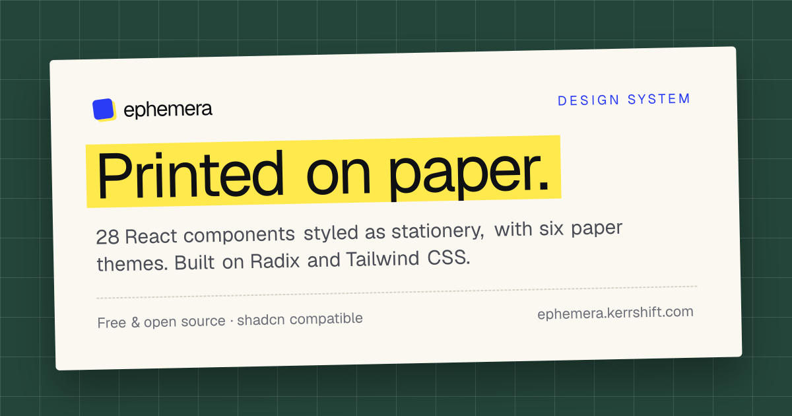

# Ephemera — Paper UI Design System for React

**A design system printed on paper.**

Ephemera is a free, open-source **paper UI design system** for React. Its components look like real stationery: buttons that press like
typewriter keys, inputs on ruled lines, folder tabs, ledger tables, label-maker badges, dialogs that arrive like
letters and toasts that print like receipts. Six paper types switch with a single attribute.

It's a [shadcn/ui](https://ui.shadcn.com) registry, so components install straight into your project as source you own.
They share shadcn's APIs, so you can swap them in one at a time.

[Website & docs](https://ephemera.kerrshift.com) · [Components](https://ephemera.kerrshift.com/#core) ·
[llms.txt](https://ephemera.kerrshift.com/llms.txt) · [Contributing](CONTRIBUTING.md)

[](https://github.com/kerrshift/ephemera/actions/workflows/ci.yml)
[](LICENSE)



## Quick start

Ephemera needs a React project with [Tailwind CSS v4](https://tailwindcss.com) and the
[shadcn CLI](https://ui.shadcn.com/docs/cli) (`npx shadcn@latest init`).

```bash
# the paper theme, its fonts and every core component
npx shadcn@latest add https://ephemera.kerrshift.com/r/all.json

# or one at a time
npx shadcn@latest add https://ephemera.kerrshift.com/r/button.json
```

The CLI merges the paper theme into your global CSS and installs the fonts (`next/font` in Next.js, `@fontsource`
packages elsewhere). There's nothing to import by hand. Pick a paper:

```tsx
<html data-paper="cream">  {/* cream · kraft · ledger · blueprint · newsprint · carbon */}
```

Then use components exactly like shadcn/ui:

```tsx
import { Button } from "@/components/ui/button";

<Button>Send letter</Button>
<Button variant="paper">Save draft</Button>
```

If your project already has shadcn components with the same names (new projects ship a `button.tsx`), the CLI asks
before replacing them. Answer `y`, or add `--overwrite` to replace them all with the paper versions.

### Short names

Ephemera is being added to the [shadcn registry directory](https://ui.shadcn.com/docs/directory) as `@ephemera`.
Once it's listed, `npx shadcn@latest add @ephemera/button` works with no configuration. Until then, add the namespace
to your `components.json`:

```json
{
  "registries": {
    "@ephemera": "https://ephemera.kerrshift.com/r/{name}.json"
  }
}
```

## What's included

**Paper Theme** – six paper types as CSS variables (`--paper`, `--ink`, `--pen`, `--rule`…), a `.paper` grain
utility and `.paper-ruled` notebook lines, plus five fonts (Fraunces, IBM Plex Mono, Courier Prime, Caveat, Anton). It
also sets the standard shadcn variables, so components you already have pick up the paper colors.

**Core (28)** – built on [Radix](https://www.radix-ui.com) for keyboard and screen reader support.

| Forms | Layout | Overlays | Display |
| --- | --- | --- | --- |
| Button, Input, Checkbox, Radio Group, Switch, Select, Slider, Date Picker | Card, Tabs, Accordion, Separator, Table | Dialog, Sheet, Popover, Tooltip, Dropdown Menu, Toast | Badge, Avatar, Alert, Progress, Skeleton, Kbd, Calendar, Breadcrumb, Pagination |

**Extras (9)** – Receipt, Ticket, Boarding Pass, Polaroid, Postage Stamp, Rubber Stamp, Envelope, Wax Seal and
Sticky Note. Each is a single self-contained file that needs only React and Tailwind.

Every component has a live demo, props table and source on [the website](https://ephemera.kerrshift.com).

## Using it with AI coding tools

[`/llms.txt`](https://ephemera.kerrshift.com/llms.txt) lists every component with its install command, and each
`/r/<name>.json` contains the full source, so coding agents can discover and install components on their own.

## Development

This repository is both the component registry and the documentation site (Next.js, exported as a static site).

```bash
git clone https://github.com/kerrshift/ephemera.git
cd ephemera
npm install
npm run dev        # http://localhost:3000
```

| Script | What it does |
| --- | --- |
| `npm run dev` | Regenerates the registry, then starts the dev server |
| `npm run build` | Regenerates the registry and exports the static site to `out/` |
| `npm run typecheck` | Type-checks the project |
| `npm run preview` | Serves `out/` locally with Cloudflare's runtime (run `build` first) |
| `npm run deploy` | Builds and deploys to Cloudflare |

```
src/registry/ephemera/   the components and paper.css (what gets installed)
registry.json            the registry index; scripts/build-registry.mjs turns it into public/r/*.json and llms.txt
src/app/                 the documentation site
src/lib/docs*.ts         usage examples and props tables
src/components/          demos and site-only components
```

`public/r/` and `public/llms.txt` are generated on every dev/build run and aren't committed.

Set `NEXT_PUBLIC_SITE_URL` to build for a different domain (it defaults to `https://ephemera.kerrshift.com`).

## Contributing

Bug reports, component ideas and pull requests are welcome. Please read [CONTRIBUTING.md](CONTRIBUTING.md) and our
[Code of Conduct](CODE_OF_CONDUCT.md) first. To report a security issue, see [SECURITY.md](SECURITY.md).

## License

[MIT](LICENSE) © [KerrShift](https://kerrshift.com)

Created by [Sahil Gangurde](https://lostmartian.in) ([@lostmartian](https://github.com/lostmartian)) and published by
[KerrShift](https://kerrshift.com), an applied intelligence lab building instruments for autonomous software.
